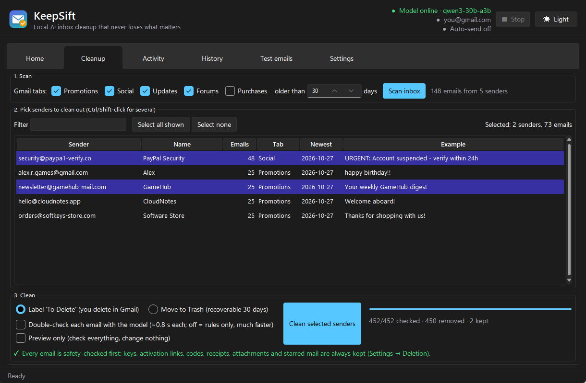
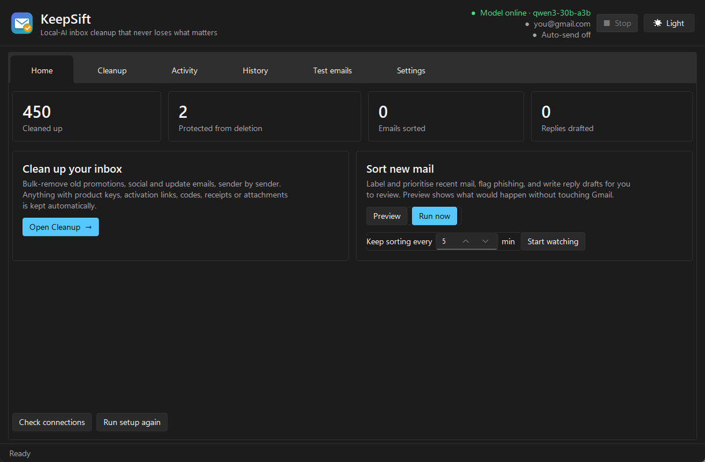
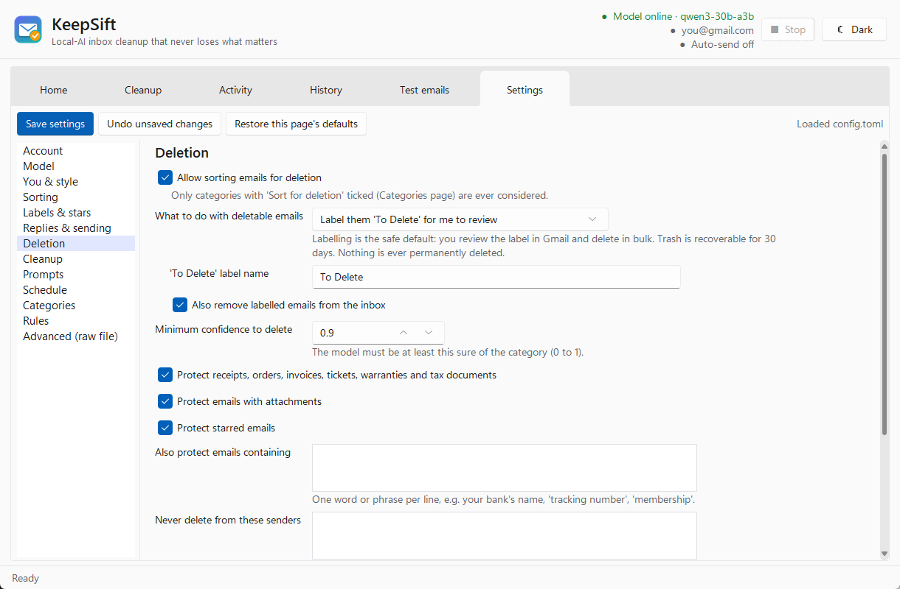

<p align="center">
  
</p>

<h1 align="center">KeepSift</h1>

<p align="center">
  <b>Clean out a huge Gmail inbox with your own local AI, without ever losing a product key, activation link or receipt.</b><br>
  Windows desktop app · runs against any OpenAI-compatible model server · nothing goes to a cloud AI
</p>

<p align="center">
  
</p>

## Why

Gmail already splits mail into Promotions, Social and Updates, but years of it pile up into tens
of thousands of emails nobody will ever read. Deleting them in bulk is scary: somewhere in there is
a software license key, a "confirm your account" link or a receipt you'll need.

KeepSift lets you clear the pile **sender by sender**, and puts every single email through a safety
net first. Your AI model runs on your own hardware, so your mail stays private.

## Features

- **Bulk cleanup**: scans Gmail's tabs, groups mail by sender (biggest first), and removes what you
  pick. Choose a "To Delete" label to review in Gmail, or Trash, which is recoverable for 30 days.
  Nothing is ever permanently deleted.
- **A safety net that isn't the AI**: fixed rules in the code (`keepsift/protect.py`) always keep:
  - product, license, serial and activation keys, game and gift-card codes, and anything key-shaped
    like `ABCDE-12345-FGHIJ`
  - activation, verification, sign-in, download and reset links, including link targets hidden in
    HTML buttons
  - 2FA and recovery codes, and security alerts
  - receipts, orders and invoices; attachments; starred mail; emails too large to check
  - your own protected words and senders

  An optional model double-check then catches the things rules can't recognise, like personal
  messages.
- **Sort new mail**: labels, priorities, phishing and prompt-injection flags, and reply drafts
  saved to Gmail Drafts for you to review. Auto-send is off by default and fenced in by an
  allowlist and send limits.
- **Made to be left running**: Watch mode with quiet hours, a Stop button (or Esc) that halts
  cleanly between emails, and progress saved as it goes, so big jobs can be stopped and resumed.
- **Every setting has a form** with an explanation: categories, rules, prompts, labels, safety
  limits. There's also a raw config page if you want it.
- **Light and dark mode** with a Windows 11 look.

<p align="center">
  
  
</p>

## Get started

You need two things: **Windows 10/11** and **a local AI model server** (see below).

**Option A: download the app.** Grab `KeepSift.exe` from the
[latest release](../../releases/latest) and run it. Nothing to install; settings are kept in
`%LOCALAPPDATA%\KeepSift`.

**Option B: run from source.** Download or clone this repo and double-click **`Setup.bat`**.
It installs Python if needed, sets everything up, adds Desktop and Start-menu shortcuts and opens
KeepSift.

Either way, a short setup wizard opens on first launch:

1. **Connect Gmail.** Create a Gmail [app password](https://myaccount.google.com/apppasswords)
   (needs 2-Step Verification) and paste it in. Your normal password is never used.
2. **Find your model.** "Find my model automatically" checks the usual local ports, or you can type
   your server's address.
3. **About you.** Your name and sign-off, used for reply drafts.

Then open **Cleanup**, click **Scan inbox**, pick some obvious junk senders, tick
**Preview only**, and see what KeepSift would keep before running it for real.

### Your model server

KeepSift talks to any **OpenAI-compatible** endpoint, on the same PC or elsewhere on your network:

| Server | Typical address |
|---|---|
| [llama.cpp](https://github.com/ggml-org/llama.cpp) `llama-server` | `http://localhost:8080/v1` |
| [LM Studio](https://lmstudio.ai) | `http://localhost:1234/v1` |
| [Ollama](https://ollama.com) | `http://localhost:11434/v1` |
| vLLM and others | `http://localhost:8000/v1` |

It uses JSON-schema structured output (`response_format`), so the server needs to support that.
An instruction-tuned model of roughly 7B parameters or more works best. Development was done
against a Qwen-family model on a llama.cpp-style server; other servers should work but are less
tested.

## How cleanup decides

```
Gmail tab + age filter ──► group by sender ──► you pick senders
                                                     │
          every email ◄──────────────────────────────┘
               │
   too big / starred? ──yes──► keep
               │ no
   keys, codes, activation links, receipts,
   attachments, protected words/senders?  ──yes──► keep (labelled "Kept - Important")
               │ no
   model double-check (optional): worth keeping? ──yes──► keep
               │ no
   label "To Delete"  or  move to Trash (30-day undo)
```

Progress is saved per email, so a rescan only shows what's left.

## Command line

`KeepSift.bat` with arguments runs the command-line tool:

```
KeepSift.bat check                      # test model + Gmail
KeepSift.bat run --dry-run              # sort new mail, change nothing
KeepSift.bat run --live                 # sort new mail for real
KeepSift.bat watch --live               # keep sorting every few minutes
KeepSift.bat try samples\*.eml          # try the model on sample emails, offline
KeepSift.bat log -n 30                  # what was done and why
```

## Privacy

- Email content only ever goes to the model server **you** configure.
- Your Gmail login is stored locally in `.env` (or `%LOCALAPPDATA%\KeepSift\.env` for the exe).
  App passwords can be revoked at any time in your Google account.
- Gmail is reached directly over IMAP/SMTP. There's no KeepSift server and no telemetry.

## Building the exe

`build_exe.bat` produces `dist\KeepSift.exe` with PyInstaller. Pushing a `v*` tag builds it on
GitHub Actions and attaches it to a release.

## License

MIT. See [LICENSE](LICENSE).
